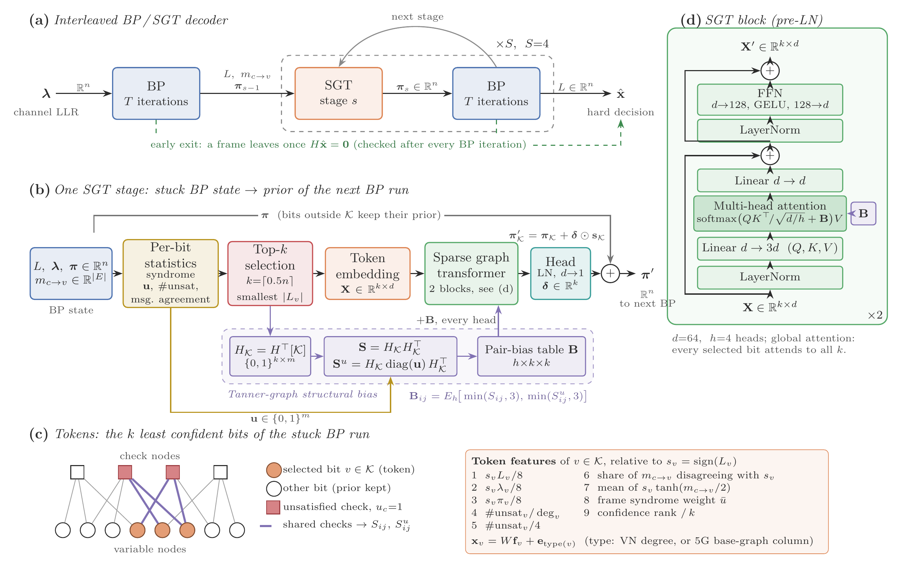

# BP-SGT architecture: paper figure

`sgt_architecture.pdf` (vector, for LaTeX), `.png` (300 dpi, for slides), `.svg`,
drawn in TikZ from `sgt_architecture.tex`. Every block matches
`../../sgt/sgt_decoder.py` with the final configuration of `../../README.md`.



## Suggested caption

> **BP-SGT decoder.** (a) The decoder interleaves $S{=}4$ sparse-graph-transformer (SGT)
> stages with $S{+}1$ belief-propagation runs of $T$ iterations ($5{\times}10$ or $5{\times}40$);
> a frame leaves as soon as its syndrome is zero. (b) One SGT stage reads the state of the
> stuck BP run, keeps the $k=\lceil 0.5n\rceil$ least confident bits $\mathcal{K}$, embeds them
> as tokens, mixes them with a transformer whose attention is biased by the Tanner graph
> (checks shared by two selected bits, and how many of those are unsatisfied), and adds a
> sign-relative correction $\bm\delta$ to their prior; all other bits keep their prior.
> (c) Selection on the Tanner graph and the nine token features. (d) The pre-LN SGT block
> ($d{=}64$, $h{=}4$, two blocks). The head is zero-initialised, so the untrained model is
> exactly BP with $S$ restarts; the model is trained end to end through all BP runs.

## Use in a paper

```latex
\begin{figure*}[t]
  \centering
  \includegraphics[width=\textwidth]{sgt_architecture.pdf}
  \caption{...}
\end{figure*}
```

## Rebuild

Needs a TeX Live with TikZ (`texlive-pictures`, `texlive-latex-extra`) and poppler.

```
pdflatex sgt_architecture.tex
pdftoppm -png -r 300 -singlefile sgt_architecture.pdf sgt_architecture
pdftocairo -svg sgt_architecture.pdf sgt_architecture.svg
```

Colours are set once at the top of the `.tex` (one per module family: BP blue,
selection red, tokens orange, structural bias purple, transformer green, head teal).
